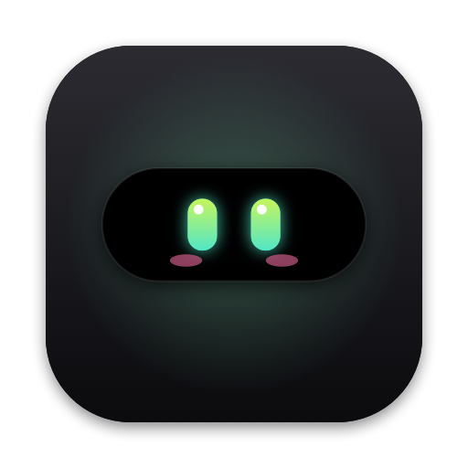
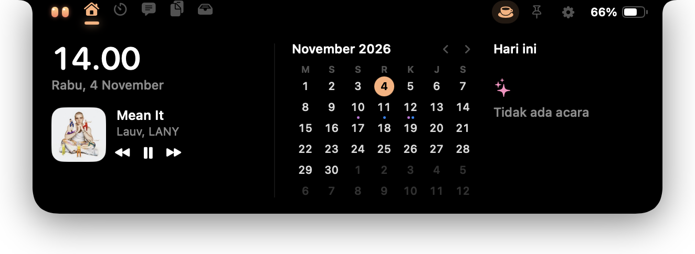
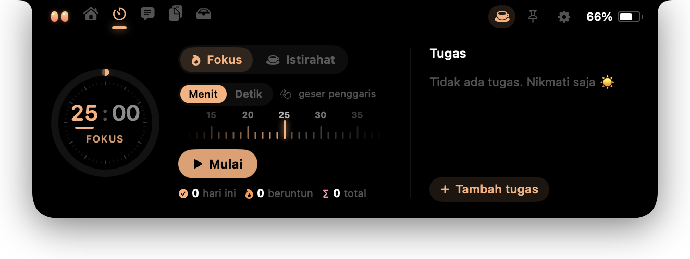
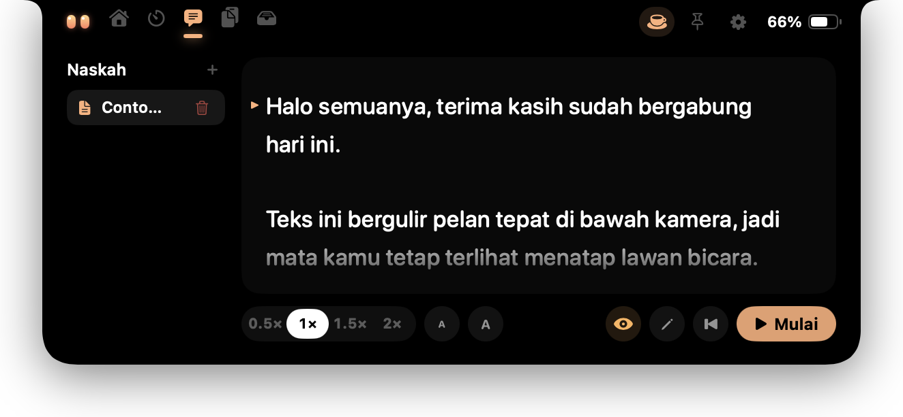
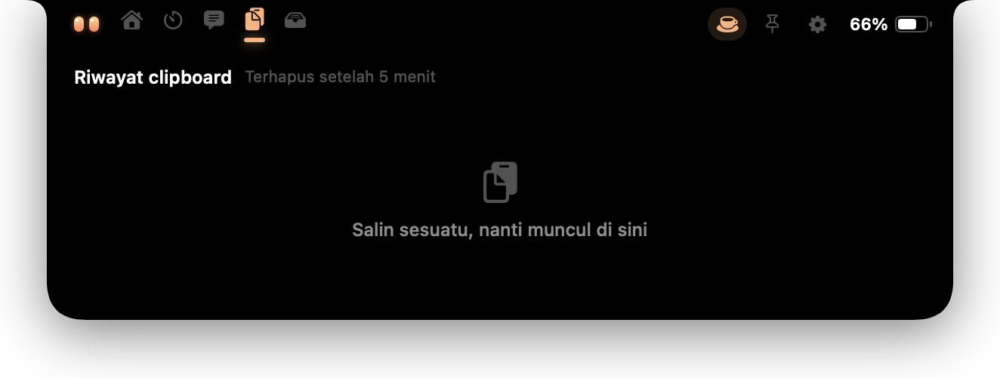
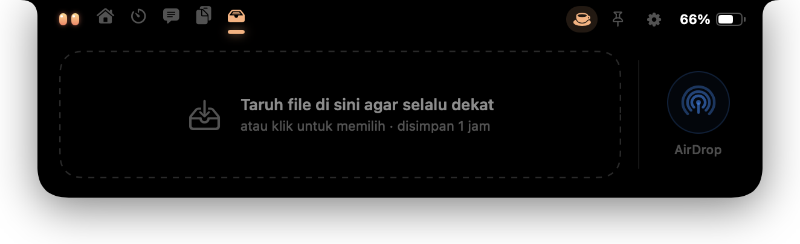
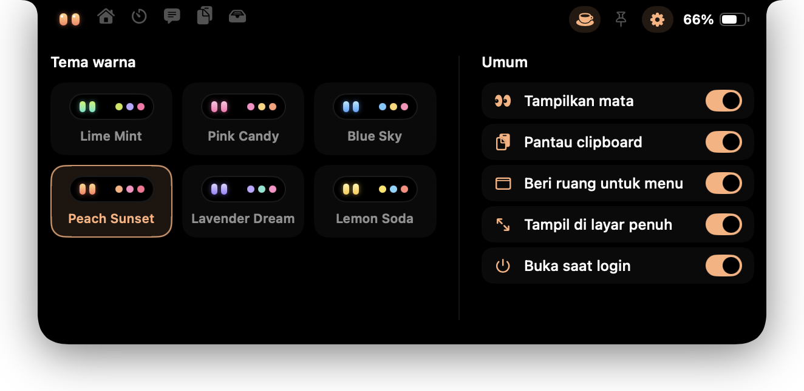

<p align="center">
  
</p>

<h1 align="center">MeNotch</h1>

<p align="center">
  <b>Ubah notch MacBook jadi pulau kecil yang hidup.</b><br>
  Musik, jam &amp; kalender, timer fokus, teleprompter, clipboard, rak file, port yang terbuka, dan akun AI — tepat di bawah kamera.
</p>

<p align="center">
  <a href="https://github.com/rezkym/MeNotch/releases/latest/download/MeNotch.dmg"><b>⬇︎ Unduh MeNotch untuk Mac</b></a>
  &nbsp;·&nbsp; macOS 15+ &nbsp;·&nbsp; 2,6 MB &nbsp;·&nbsp;
  <a href="https://github.com/rezkym/MeNotch/releases">Semua versi</a>
</p>

<p align="center">
  
</p>

---

## Cara kerjanya

Saat tertutup, MeNotch menyatu dengan notch: sepasang mata kecil menemani kamu, dan equalizer muncul saat ada musik.
**Arahkan kursor ke notch** → island terbuka. Pindah tab dengan klik ikon di atas atau **geser dua jari** di trackpad.
Jauhkan kursor → island menutup sendiri.

## Fitur

### Beranda
Jam, lagu yang sedang diputar (dengan tombol putar/jeda/lompat), kalender bulan ini, dan agenda hari yang dipilih.
Musik terbaca dari mana saja: Spotify, Apple Music, YouTube, YouTube Music, SoundCloud, TikTok web, dan aplikasi lain yang bersuara.



### Fokus
Timer Pomodoro (fokus ↔ istirahat) dengan penggaris geser untuk mengatur waktu, statistik harian & beruntun,
dan daftar tugas singkat. Hitung mundurnya tetap terlihat di notch saat island tertutup.



### Naskah (teleprompter)
Teks bergulir pelan tepat di bawah kamera, jadi mata kamu tetap terlihat menatap lawan bicara saat rapat atau merekam.
Atur kecepatan & ukuran huruf, geser teks dengan dua jari, dan **sembunyikan MeNotch dari screen sharing** dengan satu klik.



### Clipboard
Setiap kali kamu menyalin, muncul konfirmasi kecil di bawah notch. Riwayat (teks, tautan, gambar, file) bisa diklik
untuk disalin lagi dan terhapus otomatis setelah 5 menit. Isi dari pengelola kata sandi tidak pernah disimpan.



### Rak
Tempat singgah file: seret file ke notch (rak terbuka otomatis saat kamu mulai menyeret), lalu seret keluar ke mana saja
atau kirim lewat AirDrop. File disalin ke `Documents/MeNotch` dan dibersihkan setelah 1 jam — file aslinya tidak disentuh.



### Port
Daftar port TCP yang sedang dibuka di Mac kamu, lengkap dengan aplikasi atau proses pemiliknya, PID, perintah lengkapnya,
dan apakah bisa diakses dari jaringan atau hanya lokal. Cari berdasarkan nomor port atau nama, lalu hentikan dengan satu klik
— atau **Hentikan Semua** sekaligus. Layanan bawaan macOS dikelompokkan terpisah (terlipat) dan selalu ditanya dua kali
sebelum dihentikan, supaya sistem tidak ikut terganggu.

### Akun AI (Claude & Codex)
Simpan beberapa login Claude Code dan Codex CLI, lalu pindah akun aktif dengan satu klik tanpa login ulang. Setiap akun
menampilkan sisa limit 5 jam dan mingguan beserta hitung mundur reset-nya dalam bentuk cincin kecil.
Tambah akun cukup dengan **Tempel** kredensial (export 9router, `~/.codex/auth.json`, atau JSON Claude Code), **Pilih File…**,
atau **Dari Mac Ini**. Token disimpan di Keychain, dan teks berisi token tidak pernah masuk riwayat clipboard.
Gunakan hanya akun milikmu sendiri dan patuhi ketentuan layanan Anthropic / OpenAI.

### Pengaturan
Enam tema warna, maskot on/off, pantau clipboard, beri ruang untuk menu aplikasi, tampil di layar penuh, dan buka saat login.



### Hal kecil lainnya
- **Maskot** mengikuti kursor, berkedip, senang saat island dibuka, kaget saat dicolek, mengantuk saat kamu lama diam, dan bermata bintang saat charger dicolok.
- **Ngecas**: animasi colokan + perkiraan waktu sampai penuh saat charger dipasang atau dilepas.
- **Keep Awake** (ikon cangkir): Mac tidak tidur selama aktif.
- **Tahu diri**: island mengecil saat menu aplikasi atau ikon status butuh tempat di menu bar.

## Instalasi

1. **Unduh** [`MeNotch.dmg`](https://github.com/rezkym/MeNotch/releases/latest/download/MeNotch.dmg) dari halaman [Releases](https://github.com/rezkym/MeNotch/releases).
2. **Buka** file DMG, lalu **seret MeNotch ke folder Applications**.
3. **Jalankan** MeNotch dari Applications (atau Launchpad).
4. Saat pertama kali dibuka, macOS mungkin berkata aplikasi tidak bisa diperiksa — karena build ini belum dinotarisasi Apple.
   Buka **System Settings → Privacy & Security**, gulir ke bawah, lalu klik **Open Anyway** di baris MeNotch.
5. Ikuti **panduan pembuka** (3 langkah singkat) untuk memberi izin. Semuanya bisa dilewati dan diatur nanti dari ikon MeNotch di menu bar → *Panduan & Izin…*

Kebutuhan: **macOS 15 Sequoia atau lebih baru**. Paling pas di MacBook dengan notch; di layar tanpa notch, MeNotch membuat notch virtual di tengah atas layar.

### Izin yang diminta

| Izin | Untuk apa | Wajib? |
|---|---|---|
| Folder Documents | Menyimpan salinan file Rak dan gambar clipboard di `Documents/MeNotch` | Disarankan |
| Kalender | Menampilkan acara di tab Beranda | Disarankan |
| Accessibility | Menggeser island saat menu aplikasi mencapai notch | Opsional |

Semua data tetap di Mac kamu. Satu-satunya koneksi internet adalah fitur **Akun AI**: dengan token milikmu sendiri, MeNotch
membaca sisa limit dan memperbarui token langsung ke server Anthropic / OpenAI — hanya saat tab itu dibuka atau saat berganti akun.

### Menghapus MeNotch

1. Di **Pengaturan** MeNotch, matikan **Buka saat login**.
2. Bersihkan pengaturan, izin, dan file MeNotch. Jalankan **sebelum** app dihapus, karena `tccutil` perlu app-nya masih ada:

   ```sh
   osascript -e 'quit app "MeNotch"'
   defaults delete dev.rezky.MeNotch          # pengaturan
   tccutil reset All dev.rezky.MeNotch        # izin Kalender, Documents, Accessibility
   rm -rf ~/Documents/MeNotch                 # file Rak & riwayat clipboard
   while security delete-generic-password -s "MeNotch AI Accounts" >/dev/null 2>&1; do :; done  # token Akun AI
   ```

3. Hapus `MeNotch.app` dari folder Applications.

## Hemat baterai

MeNotch dirancang untuk menyala seharian tanpa terasa:

- Hampir tidak memakai CPU saat kamu diam, dan **berhenti total saat layar mati atau terkunci**.
- Animasi yang berjalan terus (equalizer, maskot bergoyang, "zZz") digambar oleh Core Animation, bukan oleh aplikasinya.
- Timer fokus, port, dan usage AI hanya bekerja saat dibutuhkan: tidak ada polling di latar belakang saat tab-nya tertutup.
- Memori stabil, tanpa kebocoran meski dipakai berjam-jam atau sering berpindah tab.

Lihat [catatan rilis](https://github.com/rezkym/MeNotch/releases) untuk detail tiap versi.

## Kredit

- Info lagu dibaca lewat [mediaremote-adapter](https://github.com/ungive/mediaremote-adapter) (BSD-3-Clause).
- Foto notch di situs: "Notch of Macbook Pro 16 inti model - 1" oleh KKPCW, [CC BY-SA 4.0](https://creativecommons.org/licenses/by-sa/4.0/), via Wikimedia Commons.

Repo ini juga berisi situs promosi MeNotch (`index.html`, `css/`, `js/`, `assets/`) — cukup buka `index.html` di browser.

© 2026 Rezky. All rights reserved.
